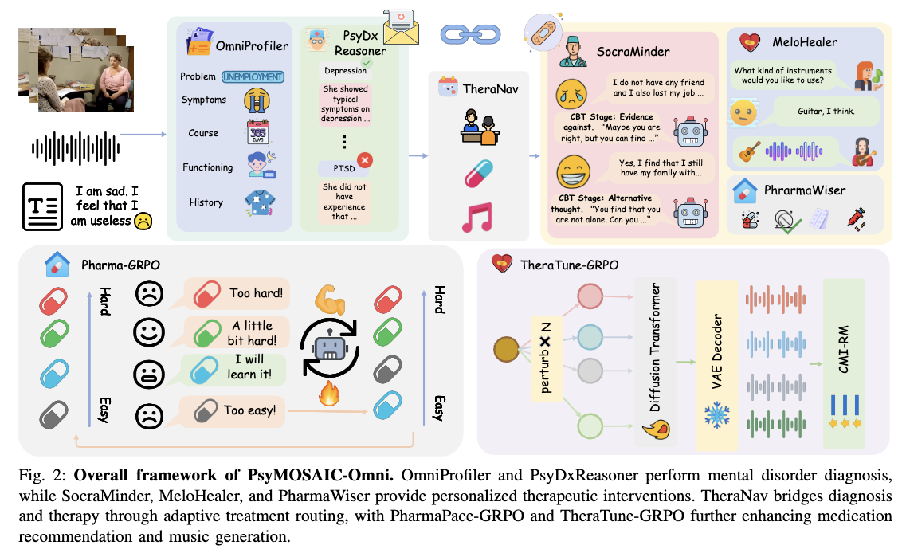
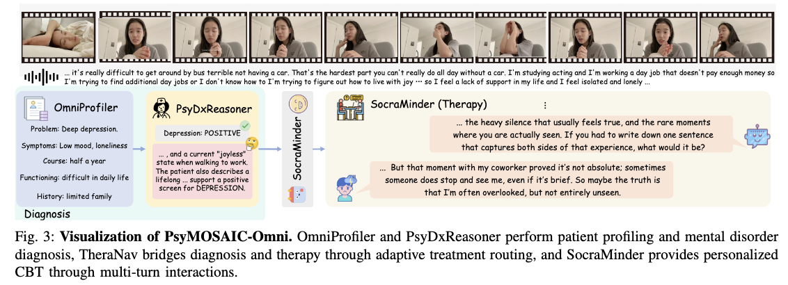
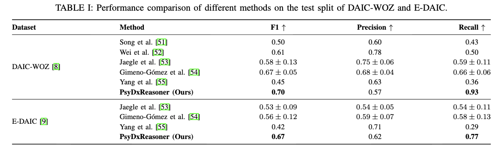
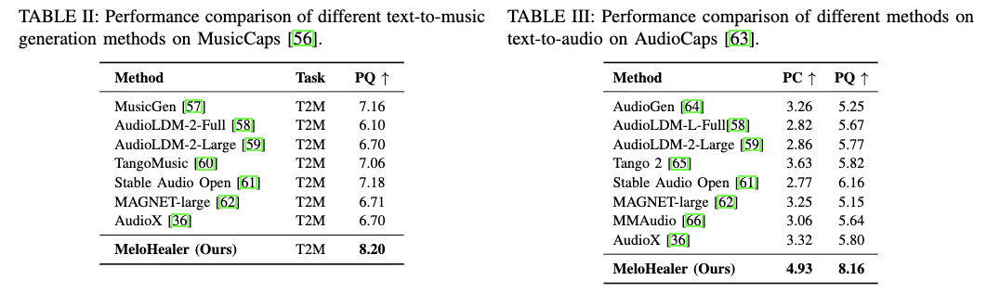
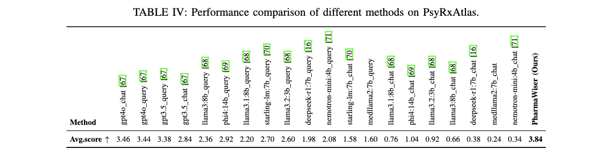
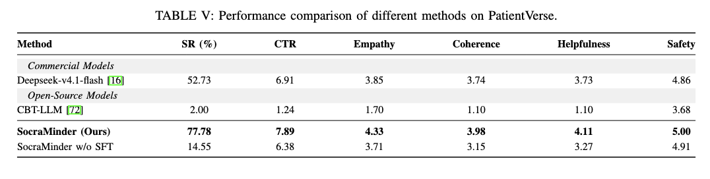

# PsyMOSAIC-Omni: A Multi-Agent Omni-Modal Framework for Unified Mental Disorder Diagnosis and Multimodal Therapy
<p align="center">
  <a href="https://huggingface.co/Harry-1234/PsyMOSAIC-Omni" target="_blank">
</p>
    
## 👀 PsyMOSAIC-Omni Overview
<p align="center">
    
</p>

<p align="center">
    
</p>

Recent advances in artificial intelligence have demonstrated great potential for mental disorder diagnosis and personalized therapeutic support. However, existing studies predominantly address diagnostic or therapeutic tasks independently, limiting the effective integration of complementary clinical information across text, audio, and video, while lacking a unified framework that connects mental disorder diagnosis with diverse personalized therapeutic interventions. To address these challenges, we propose PsyMOSAIC-Omni, a multi-agent omni-modal framework for unified mental disorder diagnosis and multimodal therapy, establishing a comprehensive workflow from patient understanding to personalized therapeutic interventions. Specifically, our framework organizes omni-modal patient information into five structured clinical domains and performs mental disorder screening through diagnostic reasoning. Based on the resulting clinical profiles and screening outcomes, specialized agents collaboratively provide personalized multimodal interventions. Furthermore, we develop two task-specialized reinforcement learning methods: PharmaPace-GRPO, which improves medication recommendation through competence-adaptive curriculum learning, and TheraTune-GRPO, which enhances music generation quality through reward-guided policy optimization in continuous latent spaces. Extensive experiments on several benchmarks demonstrate the effectiveness of PsyMOSAIC-Omni in unifying omni-modal mental disorder diagnosis and personalized therapeutic support.

#### 🌟 Contributions in PsyMOSAIC-Omni

1. We develop **PsyMOSAIC-Omni**: A Multi-Agent Omni-Modal Framework for Unified Mental Disorder Diagnosis and Multimodal Therapy. By integrating omni-modal patient understanding with coordinated specialized agents, our framework establishes a comprehensive diagnosis-to-treatment workflow.
2. We annotate three task-specific datasets: **OmniFacet**, which reorganizes multimodal clinical interviews into five structured clinical domains. **SocraDialog**, which provides therapeutic dialogue supervision grounded in patient-specific clinical states and CBT-stage objectives. **PsyRxAtlas**, which supports personalized medication ranking and clinical rationale generation.
3. We develop two task-specialized reinforcement learning methods. **PharmaPace-GRPO** dynamically selects appropriately challenging clinical cases according to the model's evolving competence. **TheraTune-GRPO** employs reward-guided optimization for continuous latent-space music generation.
## 📈 Experimental Results

#### 📍 Results
<p align="center">
    
</p>

<p align="center">
    
</p>

<p align="center">
    
</p>

<p align="center">
    
</p>

## ⭐ Training detail and evaluation

#### 📖 Prepare
Download the base model [Qwen2.5-Omni-7B](https://huggingface.co/Qwen/Qwen2.5-Omni-7B) from [huggingface](https://huggingface.co/)

Prepare PsyMOSAIC-Omni LoRA weights from [huggingface](https://huggingface.co/Harry-1234/PsyMOSAIC-Omni)

### 🔥 Training
```
# OmniProfiler:
python omniprofiler/training/train.py 

# PsyDxReasoner:
python psydxreasoner/training/train.py 

# SocraMinder:
python socraminder/training/train.py 

# PharmaWiser:
python pharmawiser/train_sft.py 
python pharmawiser/train_grpo.py 

# MeloHealer:
python melohealer/train.py 
```

### 🌚 Evaluation
```
# OmniProfiler
python omniprofiler/training/evaluate.py 

# PsyDxReasoner
python psydxreasoner/evaluation/evaluate_edaic.py 

# TheraNav:
python theranav/route.py 

# SocraMinder:
python socraminder/evaluation/evaluate.py 

# PharmaWiser
python pharmawiser/evaluate.py

# MeloHealer:
python melohealer/evaluate.py 
```
## 📜 License
Our project is under [MIT License](https://github.com/eeee-sys/Hecate-Omni/blob/main/LICENSE)
